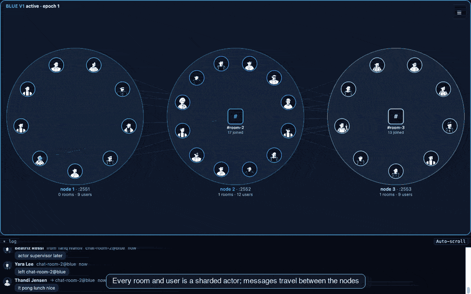

<p align="center">
  <a href="https://seonwkim.github.io/actor-spring-boot-starter/">
    <picture>
      <source media="(prefers-color-scheme: dark)" srcset="mkdocs/docs/assets/brand/lockup-dark.svg">
      
    </picture>
  </a>
</p>

<p align="center">
  The actor model for Spring Boot, on <a href="https://pekko.apache.org/">Apache Pekko</a> (the open-source fork of Akka).
</p>

<p align="center">
  <a href="https://central.sonatype.com/artifact/io.github.seonwkim/actor-spring-boot-starter"></a>
  <a href="https://seonwkim.github.io/actor-spring-boot-starter/"></a>
  <a href="https://discord.com/channels/1439734161614045205/1439734162100846655"></a>
</p>

Actors are Spring beans. Spawn them, send them messages, and scale them across a cluster, without Pekko types in your code.
Build stateful services like chat, sessions, workflows and long-running AI agents without extra middleware.

- **Actors as beans:** dependency injection, `spring.actor.*` properties, Spring lifecycle and graceful shutdown
- **Messaging:** tell, ask with timeouts, supervision, timers, routers, pub/sub topics, receptionist
- **Cluster:** sharding, singletons, replicated data, split brain resolver; join through seed nodes, Kubernetes, a database or Redis
- **Data:** event-sourced actors and projections on your `DataSource`
- **Streaming:** Reactor `Mono`/`Flux`, SSE, WebSocket and gRPC
- **Production:** Actuator health, Micrometer metrics, tracing, Grafana dashboards, rolling/canary/blue-green deployments
- **Kotlin** coroutines, and an **`@ActorTest`** slice for tests

## Run the demo

The [sharded chat example](example/sharded-chat) draws a live cluster in the browser: every room and user
is a sharded actor spread over the nodes, a cluster singleton runs the simulation, and every message
travels between the nodes as you watch. You need Java 21 and Node.js 20+.

```bash
git clone https://github.com/seonWKim/actor-spring-boot-starter.git
cd actor-spring-boot-starter/example/sharded-chat
(cd web && npm install)   # once: the page's dependencies
bin/start                 # builds the apps and starts blue's 3 nodes in the background
```

Then open **http://localhost:8080** in a browser (the cluster is ready in about 30 seconds):



- Click a room or a user to see its shard, the node it runs on and why, and every message it sent.
- Click a node's label to stop it: its rooms and users start on the other nodes within a few seconds.
- In the ☰ menu, deploy green (v2), activate it, roll back to blue, and retire the old color. The
  inactive color pauses and keeps its state; activation is a compare-and-set on the generation's epoch.
  **+ node** adds a node to a color.
- `bin/stop` stops everything.

Logs stay in memory, the last 2000 lines of each process: `bin/logs` prints the control app's, `bin/logs 2`
node 2's. The
[example's README](example/sharded-chat/README.md) explains how it is built and lists the HTTP API and the
settings.

## Quick start

Java 21+ and Spring Boot 3.5+.

```gradle
implementation 'io.github.seonwkim:actor-spring-boot-starter:1.0.0'
```

Using several modules? Import the `io.github.seonwkim:actor-bom` BOM ([Getting started](https://seonwkim.github.io/actor-spring-boot-starter/getting-started/#several-modules-import-the-bom)).

```java
@SpringBootApplication
public class MyApplication {
    public static void main(String[] args) {
        SpringApplication.run(MyApplication.class, args);
    }
}

@Component
public class GreeterActor implements SpringActor<GreeterActor.Command> {
    public interface Command {}

    public static class Greet extends AskCommand<String> implements Command {
        public final String name;
        public Greet(String name) { this.name = name; }
    }

    @Override
    public SpringActorBehavior<Command> create(SpringActorContext actorContext) {
        return SpringActorBehavior.builder(Command.class, actorContext)
                .onMessage(Greet.class, (ctx, msg) -> {
                    msg.reply("Hello, " + msg.name + "!");
                    return SpringActorBehavior.same();
                })
                .build();
    }
}

@Service
public class GreeterService {
    private final SpringActorSystem actorSystem;

    public GreeterService(SpringActorSystem actorSystem) {
        this.actorSystem = actorSystem;
    }

    public CompletionStage<String> greet(String name) {
        return actorSystem.getOrSpawn(GreeterActor.class, "greeter")
                .thenCompose(greeter -> greeter.ask(new GreeterActor.Greet(name))
                        .withTimeout(Duration.ofSeconds(5))
                        .execute());
    }
}
```

The [getting started guide](https://seonwkim.github.io/actor-spring-boot-starter/getting-started/) walks through it.

## Modules

All are `io.github.seonwkim:<module>:1.0.0`.

| Module | Adds |
|---|---|
| `actor-spring-boot-starter` | Actor system, actors as beans, messaging |
| `actor-spring-boot-starter-cluster` | Cluster, sharding, singletons, replicated data |
| `actor-jdbc`, `actor-redis` | Cluster join and leases through a database or Redis |
| `actor-persistence`, `actor-projection` | Event-sourced actors and projections |
| `actor-streams` | Reactor, SSE, WebSocket and gRPC bridges |
| `actor-metrics` | Micrometer metrics |
| `actor-kotlin` | Kotlin coroutines and reified helpers |
| `actor-test` | `@ActorTest` and cluster test helpers |

## Learn more

- [Documentation](https://seonwkim.github.io/actor-spring-boot-starter/): guides for every feature and a configuration reference
- [Examples](example): simple, cluster, chat, sharded chat, AI agents, persistence, Kubernetes, Kotlin and more
- [`llms.txt`](https://seonwkim.github.io/actor-spring-boot-starter/llms.txt) for AI assistants

## Community

- [Discord](https://discord.com/channels/1439734161614045205/1439734162100846655)
- [Issues](https://github.com/seonWKim/actor-spring-boot-starter/issues) and [Discussions](https://github.com/seonWKim/actor-spring-boot-starter/discussions)

## Contributing

Open an issue first, then a PR. Run `./gradlew spotlessApply build` before pushing.
[ARCHITECTURE.md](ARCHITECTURE.md) explains the modules, and [AGENTS.md](AGENTS.md) the testing rules.

## License

Apache License 2.0
