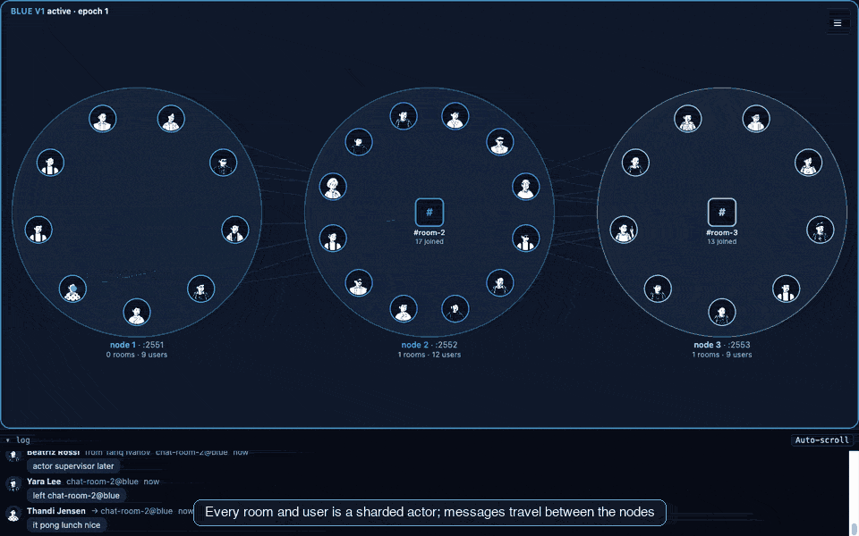

# Sharded Chat

A simulated chat on a cluster, drawn live in the browser, with a blue-green deployment you drive from the
page. Every chat room and every user is a sharded actor, a cluster singleton drives the simulation, and
every message the actors send shows up as a dot that travels between the node circles.



It only uses the starter's public API (`io.github.seonwkim.actor.*`); there is no Pekko type in the code.
Blue-green uses the starter's own support: `DeploymentGeneration`, the `jdbc` generation store,
`/actuator/generation`, the `warmup` health group and `stamp()`/`check()` fencing.

## Run it

You need Java 21 and, for the page, Node.js 20+.

```bash
cd example/sharded-chat
(cd web && npm install)   # once: the page's dependencies (needs network)
bin/start                 # builds both apps and starts the control app, which starts blue
```

Open http://localhost:8080. Blue's three nodes form a cluster and the control app activates blue (about
30 seconds); the simulation starts once blue is active.

| Process | HTTP | Cluster port | Output |
|---|---|---|---|
| control app (page, router, deployer) | http://localhost:8080 | | `bin/logs control` |
| blue nodes 1 to 3 | 8081 to 8083 | 2551 to 2553 | `bin/logs <n>` |
| green nodes 4 to 6 | 8084 to 8086 | 2554 to 2556 | `bin/logs <n>` |

The control app plays the platform: it starts the node JVMs, holds the generation store (an H2 database
over TCP that both colors share), sends the page's requests to the active color and merges the events
of both.

### Blue-green from the page

Open the ☰ menu. Its Blue-green section shows the active color and its epoch, both colors with their
version and warm nodes, and the pipeline's next step:

1. **Deploy green** starts green's three nodes with the next version (`v2`), as a cluster of their own.
   Green is ready once each node's `/actuator/health/warmup` is UP.
2. **Activate green v2** sends `POST /actuator/generation` with the epoch it expects. It is a
   compare-and-set on the one generation record: the epoch grows by one, and a stale request gets 409.
3. Within a second every node reads the new generation. Blue pauses: its users can't stamp a post
   (`DeploymentGeneration.isActive()` is false), and its rooms refuse a post stamped with an old epoch
   (`check(epoch)`). Blue's rooms and users keep their state; the page dims them.
4. **Roll back to blue v1** activates blue again (a new epoch); its chat goes on where it stopped.
   **Retire** stops the color that is not active.

The same steps from a shell:

```bash
bin/blue-green            # status
bin/blue-green deploy     # or activate, retire
```

### Things to try

- **Click a room or a user.** The drawer shows its entity type, entity id, shard and node, and why it runs
  there, with every message it sent or received. Send it a message from the bottom of the drawer.
- **Watch failover.** Click a node's label and **Stop node**: it leaves its cluster and its rooms and users
  start on the other nodes of its color within a few seconds. **Start node** brings it back. From a shell:
  `bin/stop 2` and `bin/start-node 2`.
- **Add a node.** In the ☰ menu, **+ node** beside a color starts one more node in it (`bin/add-node blue`
  from a shell), up to 6 a color. It takes the next free number from 7 on (HTTP 8080 + n, cluster port
  2550 + n) and joins that color's cluster. Rooms and users already running stay where they are; new ones
  can land on it, so raise the rooms or users to see it fill.
- **Change the load** from the ☰ menu: rooms, users and messages a second, or add a room with a number of
  your choice (the menu tells you which node it should land on, and why). These go to the active color.

Stop everything with:

```bash
bin/stop
```

### Working on the page

```bash
cd example/sharded-chat/web
npm run dev     # Vite on http://localhost:5173, /api proxied to the control app on :8080
npm test        # the page's unit tests
```

`./gradlew :example:sharded-chat:control:build` builds the page into `control/src/main/resources/static`
when `web/node_modules` exists and `npm` is on the `PATH`; otherwise it skips it.

## How it works

```
                 ┌──────────── cluster singleton ─────────────┐
                 │ ChatSimulatorActor: who is in which room,  │
                 │ opens rooms, adds users, moves them around │
                 └───────┬───────────────────────────▲────────┘
            Configure    │                           │ Hello(id, node), Outcome
                 ┌───────▼────────┐  Post (ask)  ┌───┴────────────┐
                 │ ChatRoomActor  │◀─────────────│ ChatUserActor  │
                 │ sharded entity │─────────────▶│ sharded entity │
                 │ "ChatRoom"     │   Deliver    │ "ChatUser"     │
                 └────────────────┘              └────────────────┘
         every actor publishes what it sends to the "chat-events" topic
           → each node's EventFeedActor → Server-Sent Events → the page
```

| Starter feature | Where | What it does here |
|---|---|---|
| Sharded actors (`SpringShardedActor`, `actorSystem.sharded(...)`) | `ChatRoomActor`, `ChatUserActor`, `ChatCluster` | One actor per room and per user, spread over the nodes. An entity starts on its first message, wherever its shard lives. |
| Cluster singleton (`singletonHandle()`) | `ChatSimulatorActor`, `ChatCluster.simulator()` | One simulator in the whole cluster. Every node gets a handle to it at once, a proxy to the same one; what is sent before it runs waits in the proxy. |
| `ask` with a timeout, `askToSelf` | `ChatUserActor` posting to its room, `ChatService` | A user asks its sharded room to post with `ctx.askToSelf(...)`, so the reply or the timeout comes back as a message; a room drops a share of posts on purpose (`timeout-share`) so timeouts show. |
| Topics (`SpringTopicManager`) | `ChatEvents`, `EventFeedActor` | Every node gets every event, so the page can be served by any node. |
| Cluster events (`ClusterEvent`), `cluster().members()`, roles | `ClusterMembers`, `ChatCluster` | The node circles and their status; each node joins with the role `node-<n>`, which numbers it. The simulator counts the Up members with `actorSystem.cluster().members()` before it starts. When a node leaves, the simulator re-sends `Configure` to the rooms and users that ran there, which starts them on a node that is still up. |
| `JsonSerializable` messages | every message | Messages cross nodes as JSON; `SpringActorRef` and ask replies serialize through the starter's Jackson module. |
| Timers | `ChatUserActor`, `ChatRoomActor`, `ChatSimulatorActor` | The posting pace and Hello retries. |
| Blue-green (`DeploymentGeneration`, `spring.actor.generation.*`) | `ChatUserActor`, `ChatRoomActor`, `ChatSimulatorActor` | A user stamps each post with the active epoch; a room checks it and answers a stale one with `false` at once; the simulator pauses while its color is not active. Without a color (`bootRun`, the tests) the starter's generation is always active. |
| Generation store (`actor-jdbc`) and `/actuator/generation` | `application.yml`, `SecurityConfiguration`, control `Deployer` | Both colors read one generation record; activation is a compare-and-set by expected epoch, allowed to the `deployer` user only. The control app reads each node's view (`node.active`, `node.warm`) from the same endpoint to know when a node is warm and when every node has switched. |
| `warmup` health group | `management.health.actor.warmup.min-members` | A color is ready to activate once its nodes report UP. |

Why a room runs on its node: the starter hashes an entity id into one of 100 shards
(`crc32(id) % 100`, `ShardingStrategy.defaults()`), and the shard coordinator puts a new shard on the node
holding the fewest shards of that type. The `Configure` messages carry the whole state, so a room or user
that restarts on another node is back in shape after one message.

## HTTP API

The control app on :8080. Chat requests go to the active color; an id that names a color
(`chat-user-7@green`) goes to that color. Reads merge both colors, each item with its `color`.

| Method and path | Body | Answer |
|---|---|---|
| `GET /api/chat/state` | | settings, rooms (members, node, color), users (rooms, node, color), counts |
| `PUT /api/chat/rooms` / `users` / `rate` | `{"rooms":6}` / `{"users":50}` / `{"messageRate":4}` | `{settings}` |
| `POST /api/chat/rooms` | optional `{"number":42}` | `{roomId, settings}`; 400 if it exists |
| `POST /api/chat/send` | `{"to":"chat-user-7@blue","text":"hi"}` | `{target, delivered, replied}` |
| `POST /api/chat/broadcast` | `{"room":"chat-room-2@blue","text":"hi"}` | `{target, delivered, replied}` |
| `GET /api/chat/events` | | Server-Sent Events: `message`, `log`, `member` |
| `GET /api/chat/logs` | | the last log events of both colors and the deployer |
| `GET /api/logs/{control\|node-<n>}` | | a process's output as text, the last 2000 lines kept in memory (no log files) |
| `GET /api/cluster/nodes` | | `{nodes: [{node, port, http, status, color, version, actors}]}` |
| `POST /api/cluster/nodes` | optional `{"color":"green"}` (default: the active color) | `{result}`; 409 when the color is not running or runs 6 nodes |
| `POST /api/cluster/nodes/{n}/stop` / `start` | | `{result}` |
| `GET /api/deploy` | | `{active, colors, busy, next: {deploy, activate, retire}}` |
| `POST /api/deploy/deploy` / `activate` / `retire` | | `{result}`; 409 `{error}` when that step is not possible now |

A bad field answers 400 with `{"error", "field"}`; 503 while no node of the active color is up.

Each node also serves its own `/api/chat/*`, `/actuator/health/warmup` and `/actuator/generation`.

## Settings

`src/main/resources/application.yml`, any of them also as `--sharded-chat.<key>=...`:

| Key | Default | Meaning |
|---|---|---|
| `rooms` | 4 | rooms open at the start |
| `users` | 30 | users at the start |
| `message-rate` | 2 | messages a second, all users together |
| `timeout-share` | 0.1 | share of posts a room leaves unanswered, so timeouts show |
| `seed` | random | makes a run repeat |
| `start-with-nodes` | 1 | nodes to wait for (up to 30 s) before the run starts; the control app passes 3 |
| `node` | 1 | this node's number; it joins the cluster with the role `node-<n>` (`spring.actor.cluster.roles`) |
| `version` | v1 | the release this node runs, shown on the page |
| `deployer-password` | random | the password of the `deployer` user who may activate a generation |

## Code

```
src/main/java/io/github/seonwkim/example/shardedchat/     the node
  chat/    ChatRoomActor, ChatUserActor (sharded), ChatSimulatorActor (singleton),
           ChatCluster (how to reach them), ChatService (what the API calls), settings
  events/  ChatEvents (the topic), EventFeedActor, ClusterMembers, the event format
  web/     ChatController, ClusterController, SecurityConfiguration
control/   the control app: Nodes (starts the JVMs), GenerationStoreServer, Deployer and Pipeline
           (deploy, activate, retire), EventRelay, ApiController
web/       the page: Vite, React, TypeScript, Tailwind (see web/README.md)
bin/       start, stop, start-node, add-node, blue-green
```
