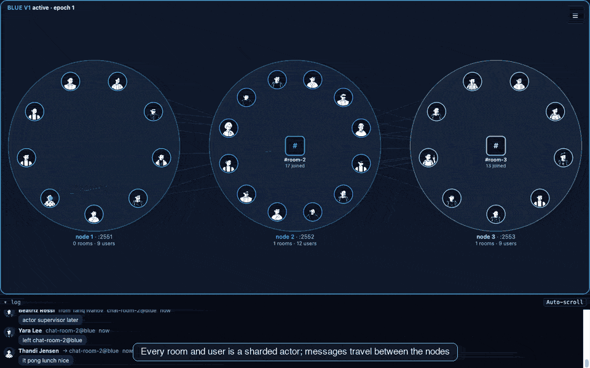

# Sharded Chat Example

A simulated chat on a three-node cluster, drawn live in the browser: every room and every user is a sharded
actor, a cluster singleton runs the simulation, and every message the actors send travels across the page
between the node circles. Stop a node and watch its rooms and users start on the others, or run a
blue-green deployment from the page and roll it back.



- **Source:** [`example/sharded-chat`](https://github.com/seonWKim/actor-spring-boot-starter/tree/main/example/sharded-chat)
- **Runs:** a control app and two colors of three nodes each on one machine, a React page served by the control app
- **Modules:** `actor-spring-boot-starter-cluster`, `actor-jdbc`, Spring WebFlux, Spring Boot Actuator

## What it shows

- Sharded actors (`SpringShardedActor`) for rooms and users; an entity starts on its first message
- A cluster singleton (`singletonHandle()`) that owns the simulation's state
- `askToSelf` with a timeout between sharded actors, and timers inside them
- `actorSystem.cluster().members()` and a role per node (`node-<n>`) to tell the nodes apart
- A distributed topic (`SpringTopicManager`) that brings every event to every node
- Cluster events (`ClusterEvent`) as Spring events: node status, and re-homing a lost node's actors
- Messages across nodes as JSON (`JsonSerializable`), with `SpringActorRef` in them
- Blue-green with `DeploymentGeneration`: a shared `jdbc` generation store, activation through
  `/actuator/generation` (a compare-and-set by expected epoch), the `warmup` health group, and
  `stamp()`/`check()` fencing so the inactive color stops posting and keeps its state

## Run it

Java 21, and Node.js 20+ for the page:

```bash
cd example/sharded-chat
(cd web && npm install)   # once
bin/start                 # builds; starts the control app (http://localhost:8080) and blue's 3 nodes
bin/blue-green deploy     # start green (v2); then activate, and retire the old color
bin/stop 2                # stop node 2: its rooms and users move to blue's other nodes
bin/start-node 2          # bring it back
bin/stop                  # stop all
```

Open http://localhost:8080. The ☰ menu runs the blue-green steps too. Click a room or a user to see its shard (`crc32(id) % 100`), its node and why
it runs there. The example's
[README](https://github.com/seonWKim/actor-spring-boot-starter/tree/main/example/sharded-chat#readme) has
the design, the HTTP API and the settings.
